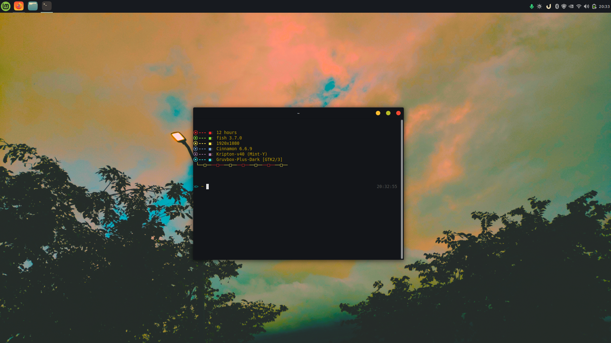

# Neofetch Config

My personal Neofetch configuration, made for a clean and minimal look on Linux Mint.



## Features

- Minimal, clean layout
- Only the info I care about
- Easy to install, just one file
- Works great with Gruvbox-style setups

## Installation

### 1. Install Neofetch

```bash
sudo apt install neofetch
```

### 2. Back up your current config (optional)

```bash
cp ~/.config/neofetch/config.conf ~/.config/neofetch/config.conf.bak
```

### 3. Download and apply my config

```bash
git clone https://github.com/oclunny/neofetch-forMint-byclunny.git
cd neofetch-forMint-byclunny
mkdir -p ~/.config/neofetch
cp config.conf ~/.config/neofetch/config.conf
```

### 4. Run it

```bash
neofetch
```

## Customization

Open `~/.config/neofetch/config.conf` in any text editor to change what is shown, the colors, the ASCII logo, and more. The comments inside the file explain each option.

## My setup

- **OS:** Linux Mint
- **Theme:** Kripton
- **Icons:** Gruvbox Plus Dark
- **Cursor:** macOS White

## Note

Neofetch is no longer actively maintained. If you want a faster, maintained alternative, check out [fastfetch](https://github.com/fastfetch-cli/fastfetch).

## License

Free to use and modify. Feel free to credit me if you share it!
